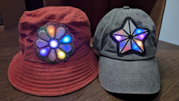

# SuperCon 2026 Powered Flowers Workshop
Workshop resources to create illuminated accessories at SuperCon 2026
 

  

## Workshop Logistics

The primary steps of this project are:
- Assembly
  - [Soldering/Electronics Assembly](assembly_electronics/README.md)
  - [Physical LED String/Diffuser Assembly](assembly_leds_diffuser/README.md)
- [Sew LED assembly to clothing/accessory](assembly_sewing/README.md)
- [WLED installation/configuration](config_wled/README.md)
-   

For efficiency, the first two steps occur parallel, so start with either step, then swap.

