# Assembly
The processes of soldering and attaching LEDs to diffusers can be done in either order. Due to limited quantities of hot glue guns, half of the workshop participants should start with each assembly step, then swap when finished.

## Electronics Soldering

### Electronic Components
- [LilyGo T-OI Plus ESP32 C3 Controller](https://lilygo.cc/en-us/products/t-oi-plus) 
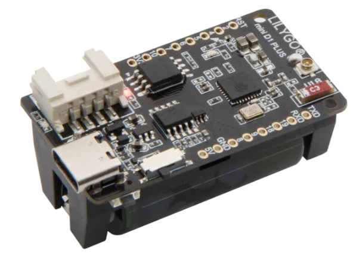
- IMNP441 Microphone 
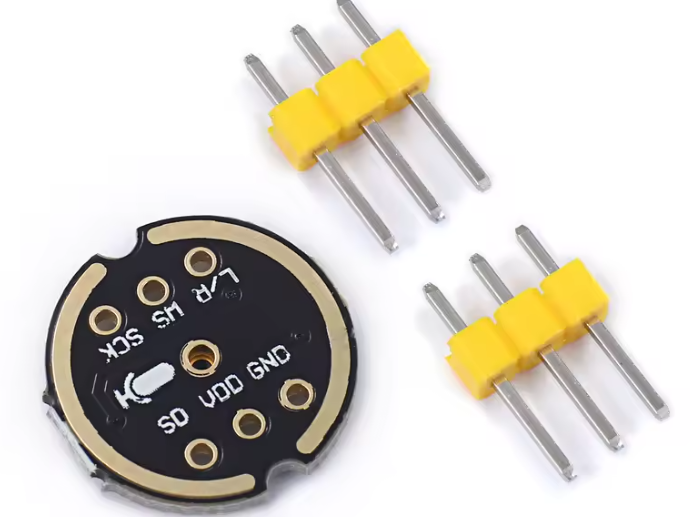
- Screw Terminal Connector 
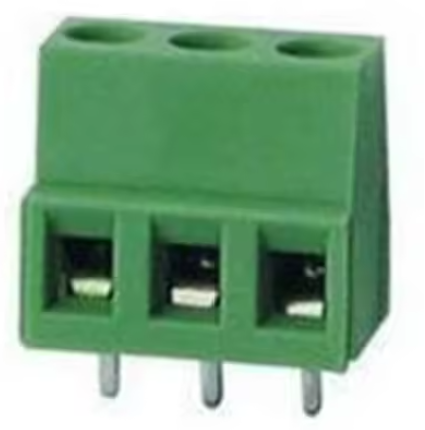
- WLED Breakout board  
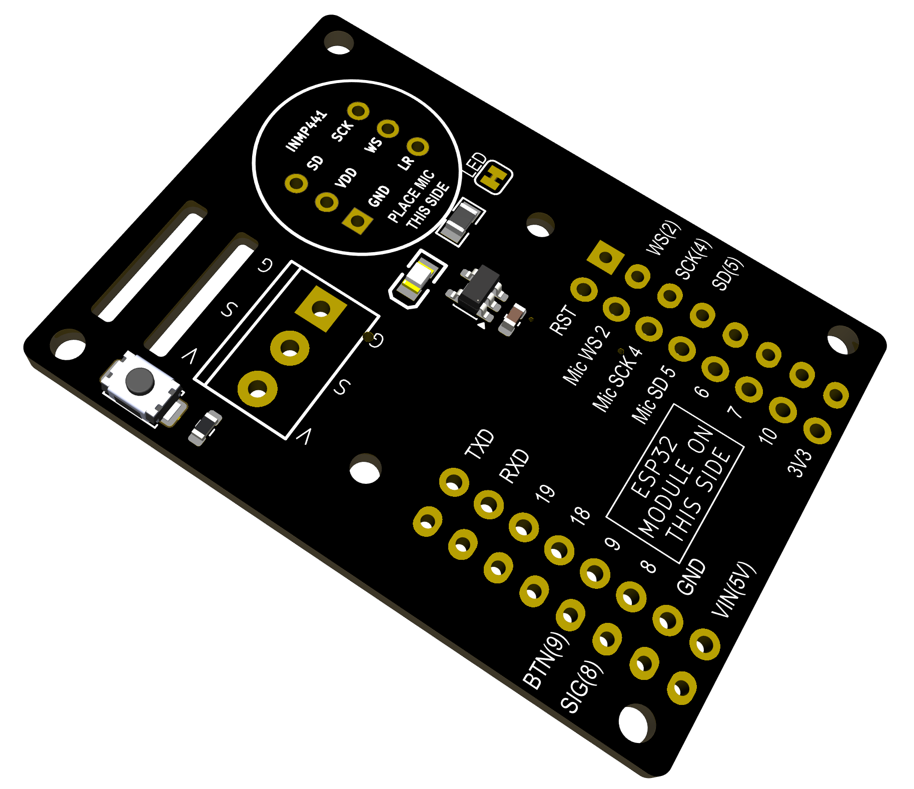

### Steps
Differing component heights make it easiest to solder the components in the order below. 
- Solder headers to microphone as shown in images below. Be careful to solder the headers to the correct side. **The header legs sit on the same side of the microphone PCB as the microphone components:** 
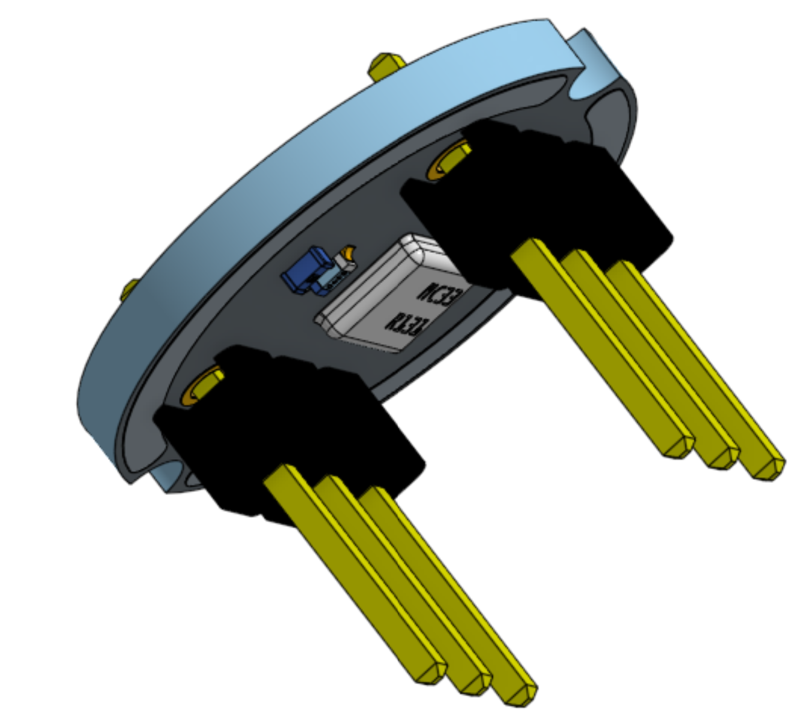&nbsp;&nbsp;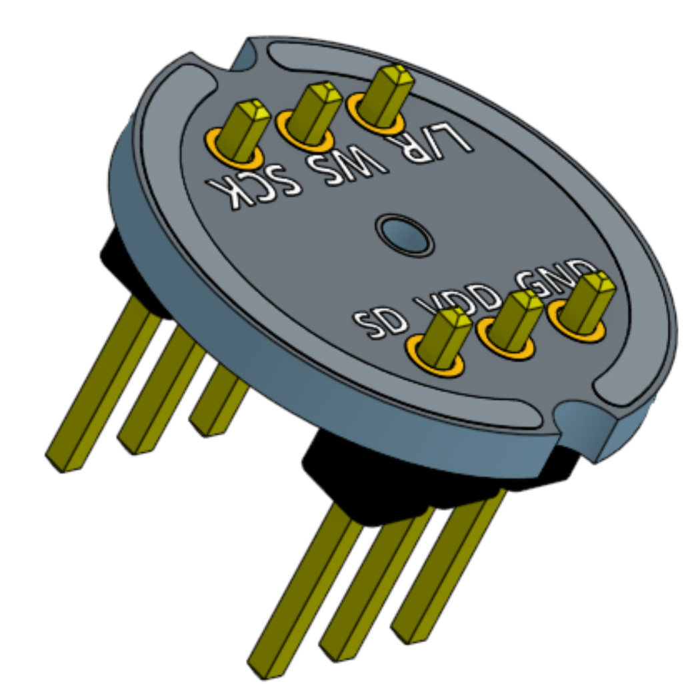  
- Solder the microphone to the top of the breakout (the side with components). **Be sure to match the corresponding pins on the breakout and microphone** 
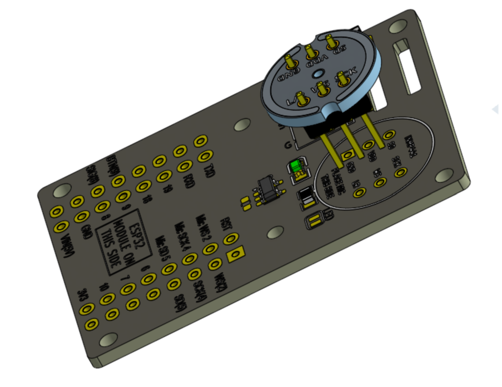&nbsp;&nbsp;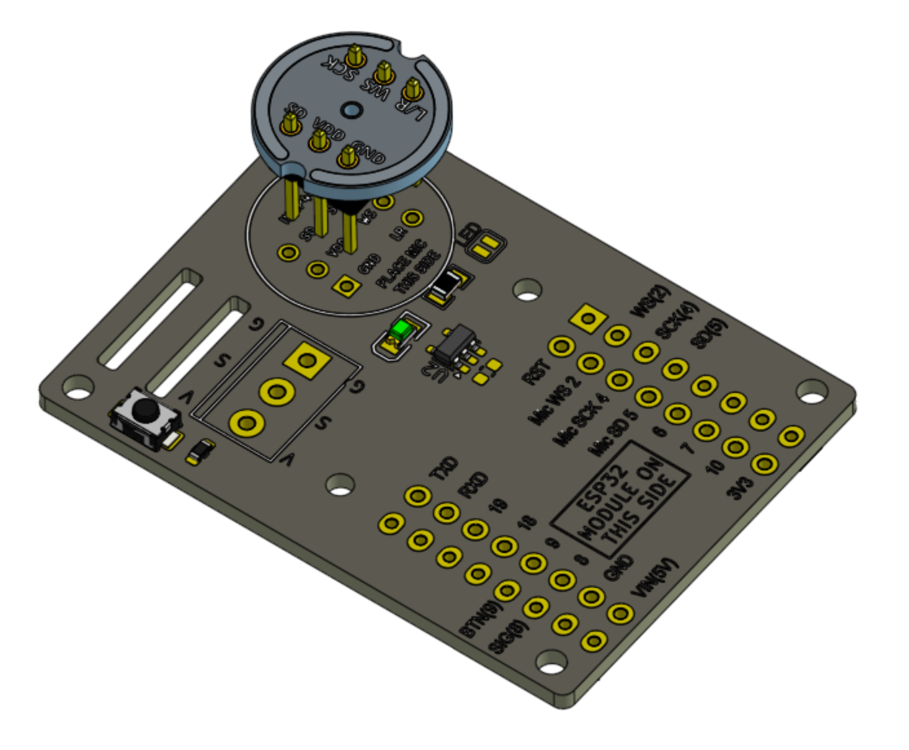  
- Solder the screw terminal to the breakout ***with the terminal openings facing the edge of the PCB*** 
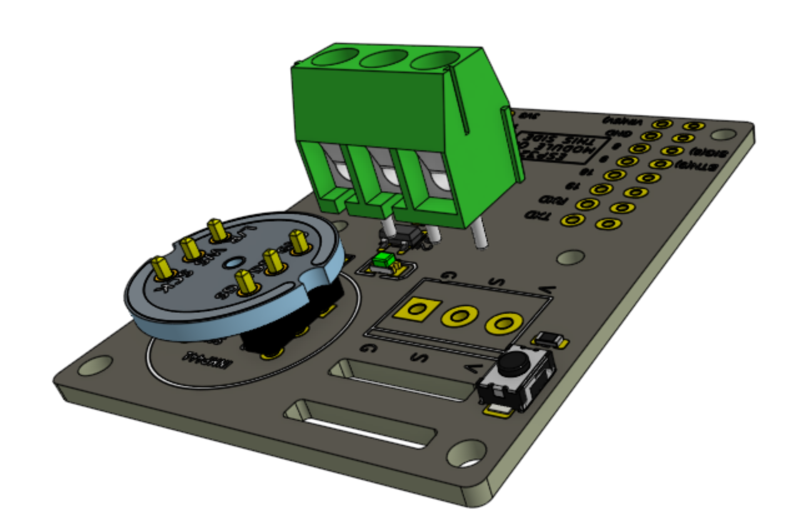&nbsp;&nbsp;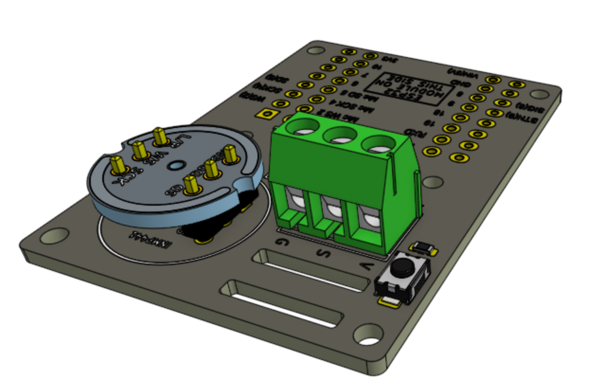  
- Solder header pins to the T-OI controller with **pin legs on the same sides as the components as shown**: 
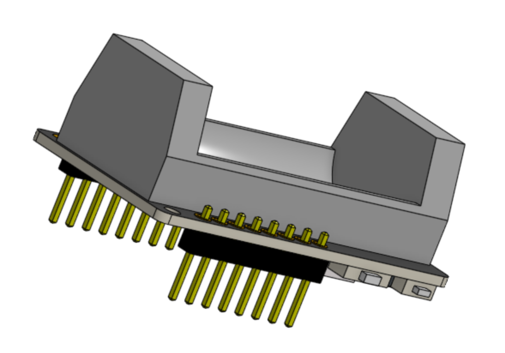&nbsp;&nbsp;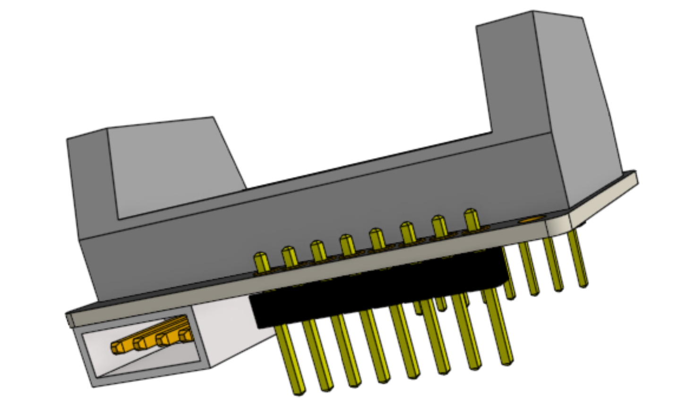  
- Solder T-OI controller to same side of breakout as microphone and screw terminal 
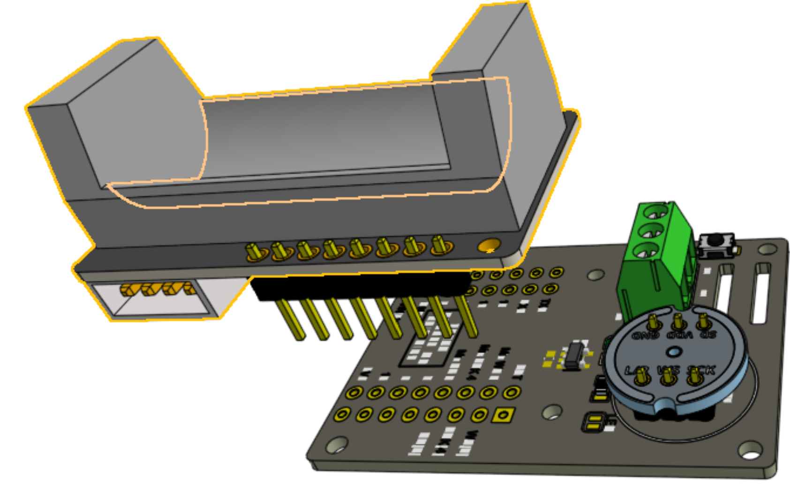&nbsp;&nbsp;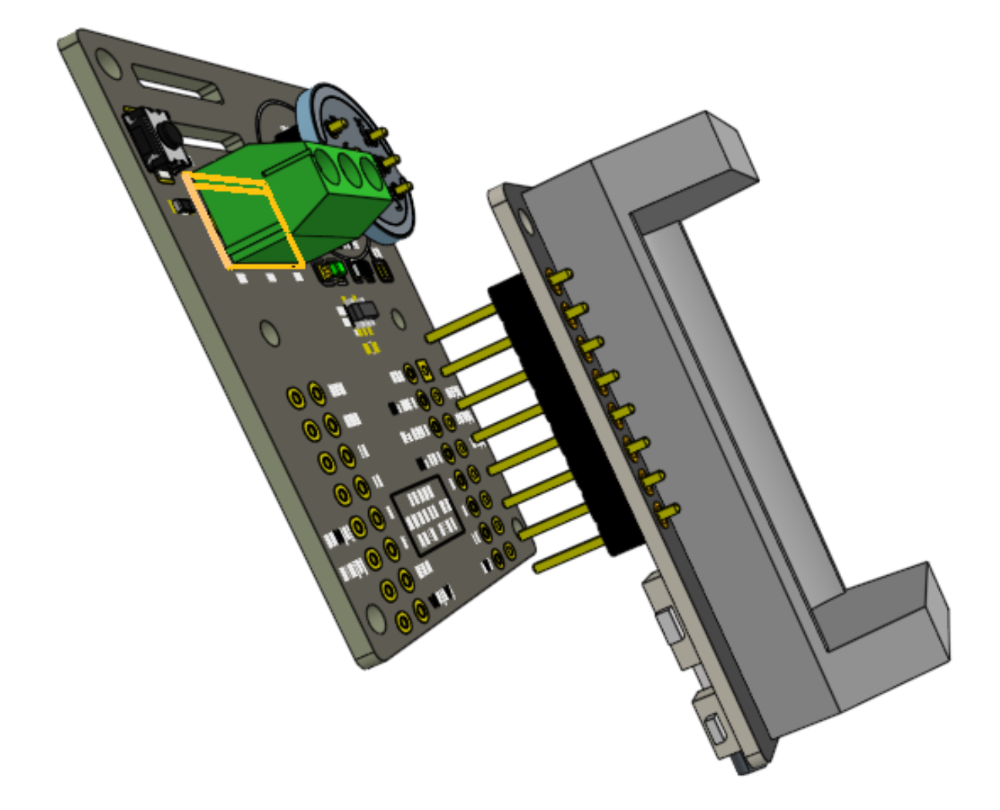&nbsp;&nbsp; 
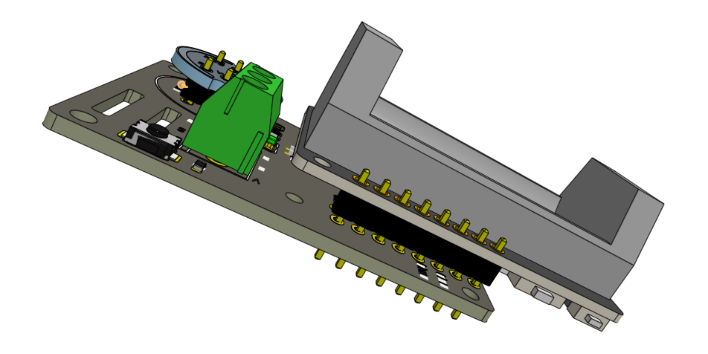&nbsp;&nbsp;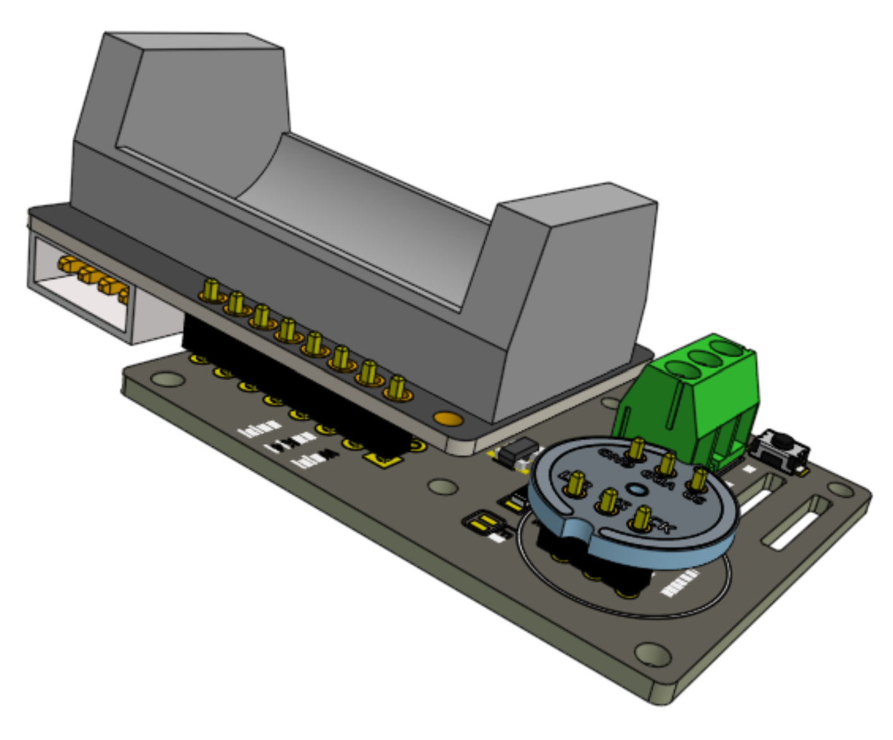 

  
