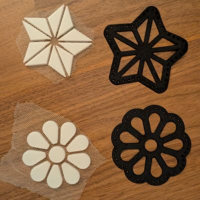
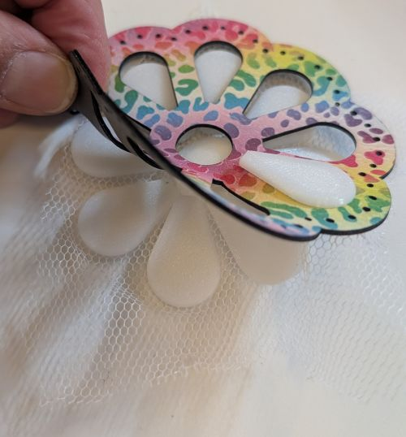
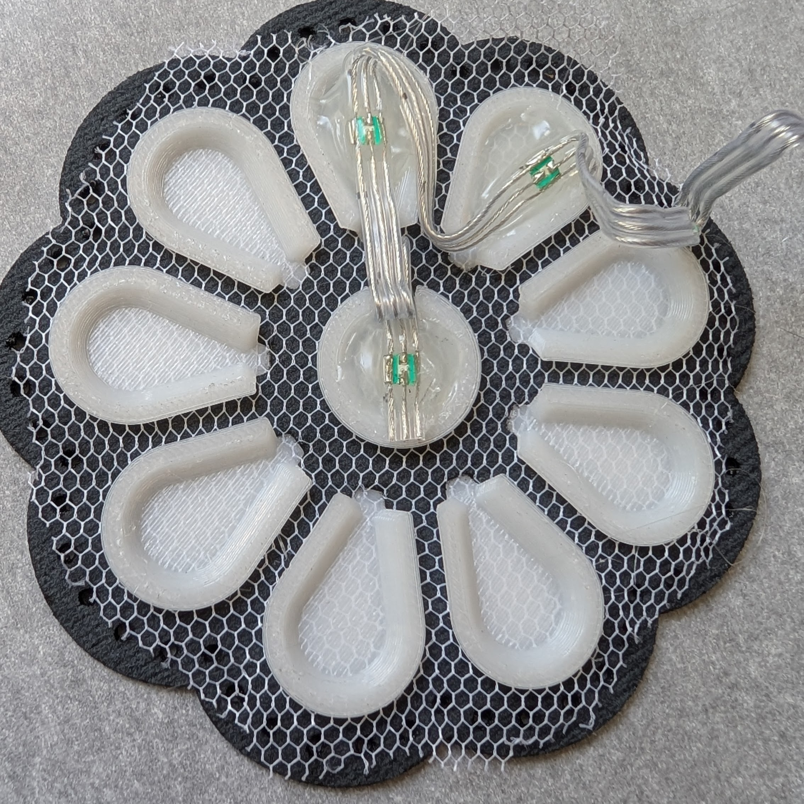
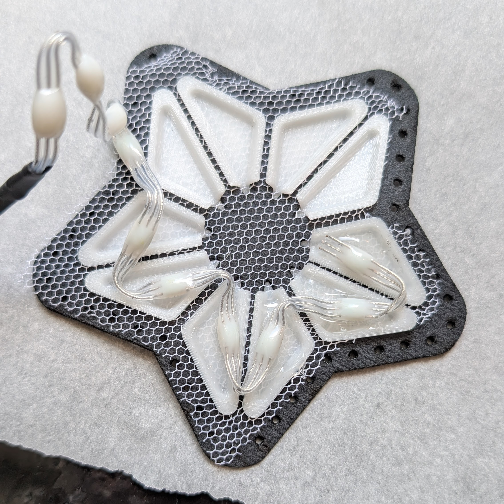
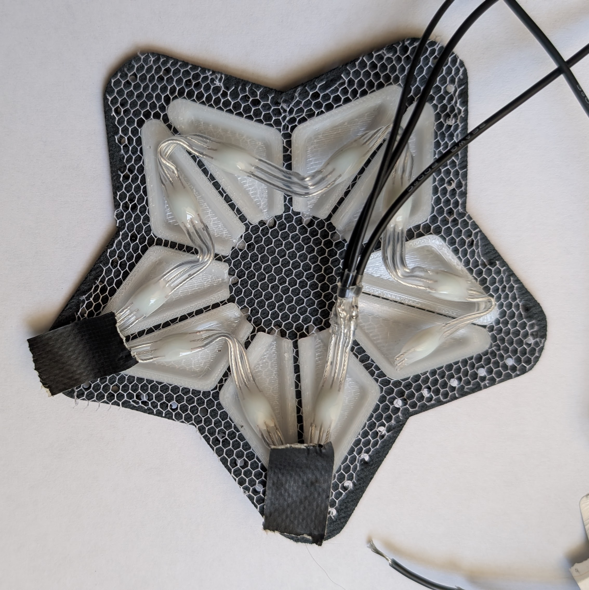

## Attaching LEDs to Diffusers
### Components
- LED String with pre-soldered extension wires
- 3D printed diffuser assembly (star or flower)
- Laser cut cover piece to match diffuser

### Steps

## Choose Diffuser and Cover
Choose the diffuser assembly shape you want, either a flower or star, and choose a faux leather diffuser cover to match. Be sure to choose the correct LED string for the diffuser you picked (the LEDs have different spacings) 
  

## Insert Diffuser into Cover
Push the diffusers through the holes in the cover from the back to the front, like buttons. The 3D printed diffusers have notches in the side, and the edges of the cover should fit into the notch. Use your fingernail to smooth the cofer it it's not seated well. 
  

## Crease/Glue LED String
Before using hot glue to attach the LED string to the diffuser assembly, fold and crease the LED string so each LED sits in the middle of a diffuser. Then go back and sew each LED down, one at a time. The patterns of the LED strings in the diffuser are shown below. 
&nbsp;&nbsp;&nbsp;&nbsp;  

