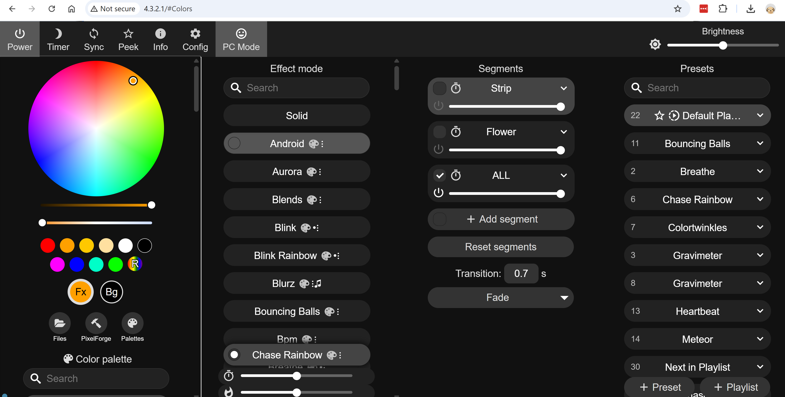
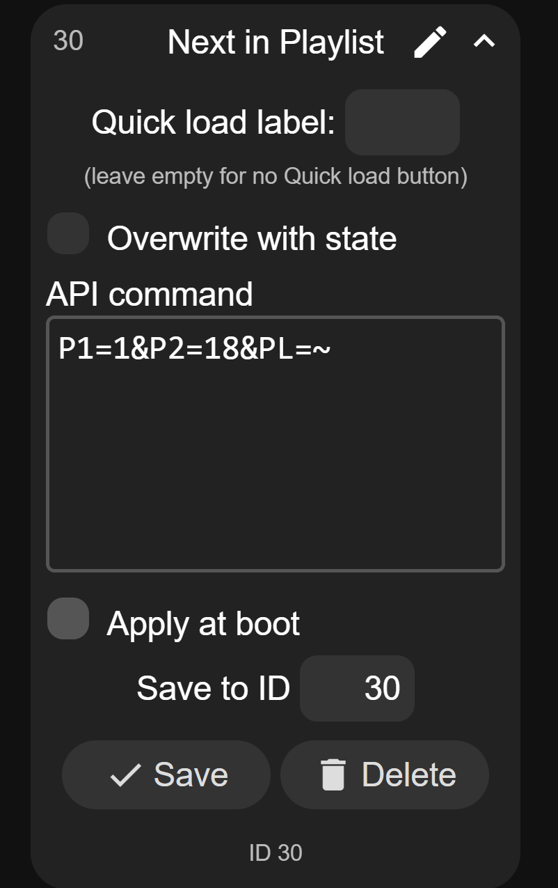
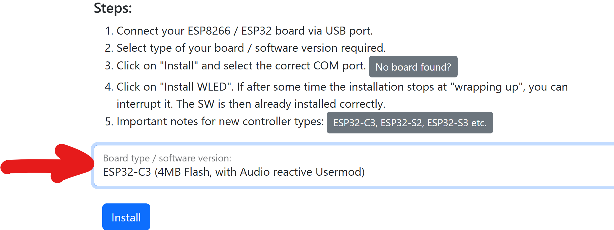

# WLED links and configuration files

## Accessing your WLED

Find the access point for your board - default name is **WLED-SCONXXX** where **XXX** is the one or two digit number matching the sticker underneath the battery on the board. The default password is **wled1234**. Connecting to it should bring up a captive portal with the control web page, but if not, open a browser and go to IP address **4.3.2.1** in the address bar. You will see the WLED control panel shown below: 
  

## Fix "Next in Playlist" Preset

In the effects list at the right of the screen, expand preset #30 and change the command to the text shown below: 
  

## Flashing WLED (For reference. This has been done for you)

To save time, the LilyGo T-OI ESP32 controllers have been pre-flashed with WLED, but if you'd ever like to re-flash them, the information is below: 

The easiest way to flash WLED to an ESP is through the official online installer at (https://install.wled.me/)[https://install.wled.me/], but I sometimes have trouble correctly flashing an ESP32-C3 with it. I have more consistent success with this online installation site (https://wled-install.github.io/)[https://wled-install.github.io/]

You can also download and flash the binary from the second site yourself. We are using the standard version audio-reactive WLED firmware from the nightlhy build, esp32-C3 with 4MB RAM 

JSON files for installing the presets (wled_presets_teardown.json) and configurations (wled_cfg_teardown.json) are included in this directory. These can be imported directly into WLED from the "Security and Updates" configuration page.
  
If you want to manually set the configuration, these are the pin assigments.

- Hardware Configuration
  - 10 WS2812 LEDs on **pin 8** (set in "LED & Hardware" configuration page)
  - push button on **pin 9** (set in "LED & Hardware" configuration page)
  - I2S microphone IMNP441 (set in "Usermods" configuration page)
     - SCK **pin 4**
     - WS **pin 2**
     - SD **pin 5**
- 

